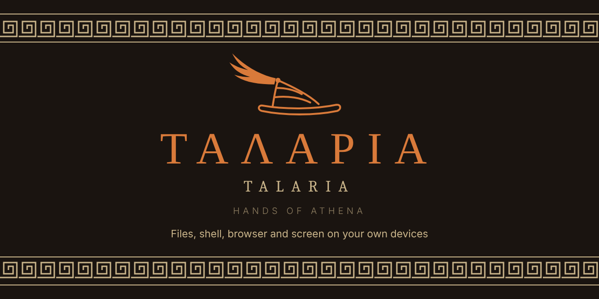

# Talaria



Hands for Hermes on the device in front of you. Athena runs on one server. When she lists, reads,
writes or runs something, Talaria does it on a named device of yours (by default the one you are
talking to her from) and never on the server.

Named after Hermes' winged sandals. Status: **early testing.** The Desktop plugin is tried on a Mac (zsh) and Windows (PowerShell)
against one backend, including one device reached from the other. The background helper is new and
tested only in the automated tests so far. Not for daily use yet.

## How it works

One installable Hermes plugin, `talaria/`, with two halves:

- **The agent half** (`talaria/__init__.py`, `talaria/core.py`) adds the tools `talaria_devices`,
  `talaria_list`, `talaria_read`, `talaria_write` and `talaria_run`, plus a `/talaria` command. It also
  keeps the device registry.
- **The device half** comes in two forms that speak the same protocol:
  - `talaria/desktop/plugin.js`, a stock Hermes Desktop plugin. It needs no modified app and does the
    work through the app's own native bridge, so the app has to be open.
  - `helper/talaria-helper.mjs`, a background helper (Node 22 or later, no other dependencies). It
    keeps the machine reachable with the app closed. When both run on one machine, the app hands
    the helper the chats it shows and stops doing the work itself (a switch in its settings).

They talk through the plugin's routes on the dashboard (`/api/plugins/talaria/…`), which sit behind
the dashboard's login. Each device has its own Ed25519 key, and every call it makes is signed. The
server never broadcasts what to do, only "device X has a request". The device then fetches the request
and returns a signed result that names exactly the request it ran. See
[docs/protocol.md](docs/protocol.md).

**Folder rules are enforced on the device.** Each device has a list of allowed folders (Settings →
Plugins → Talaria). Anything outside them is refused there, whatever the server asks. An empty list
allows nothing.

**Which device.** Every tool takes an optional `device`. Without it, the target is the device where
this conversation was most recently focused or sent from. If there is none, for example a chat from a
phone, the call is refused and the online devices are listed. It never falls back to the server.

## Trying it on one machine

Hermes and Hermes Desktop running on the same PC is the simplest setup.

1. Copy the `talaria` folder into the `plugins` folder of your Hermes home (the folder that holds
   `config.yaml`). For development, link it instead so edits apply.
2. In `config.yaml`, add `talaria` under `plugins: enabled:`, then restart the Hermes backend.
3. In Hermes Desktop, open **Capabilities → Plugins** and turn on **Talaria**. Press **Rescan**
   first if it isn't listed. It ships switched off.
4. Open **Settings → Plugins → Talaria**. Pick a device name and list the folders Athena may use, one
   per line. The status line shows "Waiting for approval" with the device's key. In a chat, type the
   `/talaria approve …` line it shows. The status line then says "Online as …".
5. Ask Athena to call `talaria_devices`, then for example to list one of those folders.

**Every device must use the same backend.** Device presence lives in the backend's memory. A Desktop
that runs its own built-in backend reports to that one, and other devices see it as offline. On
the machine that hosts Hermes, point Desktop at the shared dashboard too (Settings → Gateways →
Remote gateway).

With a remote backend, Desktop cannot copy the device half from the server's disk. Copy
`talaria/desktop/plugin.js` into `<Hermes home>/desktop-plugins/talaria/` on each device (on
Windows `%LOCALAPPDATA%\hermes`, on a Mac `~/.hermes`), then press **Rescan** in Capabilities →
Plugins. Repeat after an update that changes `plugin.js`. **Install from Git** with the Desktop
target checked should also work, but has not been tried.

## The background helper

```
talaria-helper setup        # dashboard address, sign-in, device name
talaria-helper install      # run in the background at every login
talaria-helper status
talaria-helper folders add <path>    # or: remove <path>; read again within seconds
talaria-helper oikos <address>       # also serve Athena on Oikos (below)
```

- **Sign-in.** It signs in once with the dashboard's username and password and keeps only the
  session the dashboard hands back, which it renews by itself (30 days without contact ends it;
  then run `talaria-helper login`). The password is not stored.
- **Secrets.** The device key and that session are kept in the login keychain on a Mac, protected by
  the Windows account (DPAPI) on Windows, and in a file only the user can read elsewhere.
- **Background.** A LaunchAgent on a Mac, the per-user Run key on Windows (no administrator rights),
  a systemd user service on Linux. It runs from a copy in its settings folder, which the sync
  scripts refresh.
- **Sharing a name with the app.** The helper is a second key for the same computer. Approve it
  once with its key (`/talaria approve <name> <key>`); after that both keys stay approved and
  whichever is online does the work, so switching between the app and the helper needs no new
  approval; while both are online the helper answers. `/talaria devices` and approvals label each
  key `(app)` or `(helper)`. `/talaria revoke <name>` locks out both.
- **Folders.** Its own list, in its `config.json`. Every path is checked again after resolving
  symlinks, so a link inside an allowed folder cannot lead out of it, for any operation.
- **Settings in Desktop.** Talaria's settings in Hermes Desktop have one device name and one list
  of allowed folders, used by the app and passed on to the helper within seconds. The helper's
  dashboard address defaults to the gateway Desktop is bound to (Settings > Gateway). **Install
  helper**, **Update helper** and **Remove helper** buttons run the commands below in the app's own
  terminal (Node 22 or later must be installed), taking the helper from the dashboard so its
  version matches the server half. A sign-in box appears there when the helper is signed out. On
  a machine without Desktop, use `talaria-helper folders add <path>`.
- **Local port.** It listens on 127.0.0.1:47219 for the Desktop app only (status, which chats are
  open, and its settings). Requests from web pages are refused. Reading or changing settings also
  needs the `local-token` file in the helper's settings folder, which only this user can read.

**Steering the agent.** On the machine that hosts Hermes, the built-in file and terminal tools reach
the same disk as Talaria and can look right. So Talaria also adds a short section to each new
session's system prompt: the user's devices are reached only through `talaria_*`. Hermes builds
without plugin prompt sections skip it; there, put the same line in the agent's standing
instructions.

**Updating.** `scripts/sync-talaria.sh` (Mac) and `scripts/sync-talaria.ps1` (Windows) pull the
checkout, copy the device half into Desktop's plugin folder, and refresh and restart the background
helper if it is installed. On the Windows machine that runs the dashboard as the "Hermes Dashboard"
scheduled task, the PowerShell one restarts it too. Run either once with `--install` / `-Install` to
put `sync-talaria` and `talaria-helper` on the PATH.

**Several agents.** Every agent on one backend uses the same devices: helper agents the main agent
spawns inherit its Talaria tools and its default device, and each Hermes profile on the backend sees
the same device list and approvals (kept in the root Hermes home). Requests from different agents
can run on one device at once; each command gets its own terminal. There is no per-agent limit yet,
such as one agent allowed only one device.

## On Oikos

Athena is moving to Oikos (`Kaylachuuu/Oikos`), which runs her turns itself. There, her `talaria_*` tools are Oikos's
own, by the same names and in the same shape (Oikos `code/oikos/hands.py`, `design/hands-on-oikos.md`), and the
background helper reaches her through Oikos's gateway instead of the dashboard:

```
talaria-helper oikos ws://10.0.0.8:11600    # then restart it: talaria-helper install
```

- **The same key and the same work.** It signs in with this machine's key over Oikos's protocol (`oikos/1`), says
  what it allows (`device.offer`: its folders, its shell, and whether the browser and the screen are on), and answers
  each request with a result signed for exactly that request. Every path is checked here, as now.
- **Approved at Oikos's console**, the first time: `devices.approve <name> <person>`. A device is reached only in a
  conversation with its person.
- **Beside the dashboard or instead of it.** With both a dashboard address and an Oikos address it serves both while
  she is on both; `talaria-helper oikos off` stops serving Oikos. `talaria-helper status` shows each.
- Hermes Desktop's own device half (the app without the helper) stays with Hermes.

## Browser and screen

Two more tools, done only by the background helper and only on a device where they are switched on
in Talaria's settings in Hermes Desktop (both start off):

- **`talaria_browser`** opens a browser window the user can watch, with a profile of its own under
  the helper's settings folder (never the everyday profile; sites signed in to there stay signed
  in). Pages come back as text with numbered links, buttons and fields, so models without vision
  can use it; `screenshot` returns an image as well. Chrome, Edge and Brave are driven over the
  DevTools protocol, Firefox over WebDriver BiDi, Safari through `safaridriver` (turn on Develop >
  Allow Remote Automation once). Only http and https pages are opened or read back, addresses with
  a password in them are refused, and Chrome-family downloads are blocked. Needs Node 22 or later
  for Chrome, Edge, Brave and Firefox.
- **`talaria_screen`** takes screenshots of the main screen and clicks, types, presses keys and
  scrolls, with what the OS already has: PowerShell and .NET on Windows, `screencapture` and
  JavaScript for Automation on a Mac (allow Screen Recording and Accessibility for the helper),
  `xdotool` and ImageMagick on Linux X11. Every action returns a fresh screenshot, scaled to 1280
  pixels wide; coordinates refer to it.

A device lists what it allows (`can` in `talaria_devices`), and the server refuses a browser or
screen call to a device that does not.

## What is not done yet

- The first key to claim a name keeps it until `/talaria forget`. A new key waits for approval:
  the device's status line shows its key, and you type `/talaria approve <name> <key>` in a chat.
  Approval happens only through that command, never through a tool, so the agent cannot approve.
- If a device is lost, `/talaria revoke <name>` refuses its key from then on and frees its name. The
  lost device also holds the dashboard login, so change the dashboard password too.
- In the Desktop app, the private key is kept in the plugin's storage, not in the OS keychain, and
  write and run cannot detect a symlink that leads out of an allowed folder (list and read check the
  resolved path). The background helper has neither gap.
- Commands run in the device's own shell: zsh/bash/sh/fish, or PowerShell on Windows. `cmd.exe` is
  refused. A command that reads from the terminal will wait until its timeout.
- Hermes' own `terminal` and file tools are not rerouted yet; Talaria has its own tools.
- Not supported: `dashboard.turn_isolation`, `plugins.isolation: host`, and Desktop connected to its
  backend over SSH (refused, since its terminal would run on the server).
- The background helper runs while you are logged in to the machine, not before.
- A server-side cancel does not reach the background helper; it stops a command at its own timeout.
- One person. Hermes has no user accounts, so any chat can name any device. If that changes, the
  likely path is one Hermes profile per person, each with its own device list.

## Layout

```
talaria/                 the plugin (install this folder)
  plugin.yaml
  __init__.py            tools and /talaria
  core.py                devices, signatures, broker
  dashboard/             routes under /api/plugins/talaria/
  desktop/plugin.js      the device half, in Hermes Desktop
  tests/                 pytest (Python) and node:test (JS)
helper/talaria-helper.mjs  the device half, as a background helper
scripts/                 sync-talaria for Mac and Windows
docs/protocol.md
```

Tests: `python -m pytest talaria/tests` (needs Hermes' Python environment for `cryptography`), and
`node --import ./talaria/tests/js/register.mjs --test talaria/tests/js/plugin.test.mjs talaria/tests/js/helper.test.mjs`.
The Python tests also run the real helper against a real dashboard server when `node` is installed.

## License

MIT. See [LICENSE](LICENSE).
